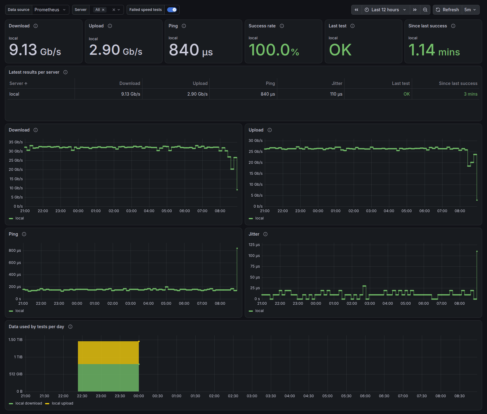

# librespeed-exporter

A Prometheus exporter that periodically measures download, upload, latency and jitter against [LibreSpeed](https://github.com/librespeed/speedtest) servers and exposes the results on `/metrics`.

Measurements are made by [librespeed-cli](https://github.com/librespeed/speedtest-cli), the project's official client. The exporter runs the CLI on a fixed interval, one server at a time, and keeps the latest result. A Prometheus scrape only reads that result: it never triggers a test or waits for one.

Optionally, it also probes each server's latency continuously, like the LibreSpeed web stability test, to catch short drops between speed tests (`stability.enabled`, see [docs/usage.md](docs/usage.md#stability-probing)).

## Installation

### Container

The image already includes librespeed-cli.

```sh
docker run -d --name librespeed-exporter \
  -p 9469:9469 \
  -v "$PWD/config.yml:/etc/librespeed-exporter/config.yml:ro" \
  ghcr.io/jansouza/librespeed-exporter:0.2
```

Images are available for `linux/amd64`, `linux/arm64` and `linux/arm/v7` (Raspberry Pi).

### Binary

Download the exporter from the [releases page](https://github.com/jansouza/librespeed-exporter/releases) and librespeed-cli from [its releases](https://github.com/librespeed/speedtest-cli/releases). Both binaries are static. Put librespeed-cli in `PATH`, or point `librespeed_cli.path` in the configuration at it.

`scripts/fetch-librespeed-cli.sh` downloads the CLI, verifies its checksum and extracts the binary and its license into a directory:

```sh
./scripts/fetch-librespeed-cli.sh 1.0.14 linux amd64 /tmp/librespeed-cli
sudo install /tmp/librespeed-cli/librespeed-cli /usr/local/bin/
```

To run it as a service, there is a systemd unit in [deploy/systemd](deploy/systemd/librespeed-exporter.service). It expects the binaries in `/usr/local/bin` and the configuration in `/etc/librespeed-exporter/config.yml`.

## Configuration

The minimal configuration is the list of servers:

```yaml
servers:
  - name: home
    url: https://speed.example.com/
```

`name` becomes the `server` label on the metrics. With the defaults, each server is tested every 30 minutes, with 15 seconds of download and 15 of upload.

Every field is commented in [librespeed-exporter.example.yml](librespeed-exporter.example.yml), and the full reference is in [docs/usage.md](docs/usage.md). To apply a new configuration without restarting, send `SIGHUP` to the process or `POST /-/reload`.

### Bandwidth use

Each test really transfers what it measures. On a 500 Mbps link, a test with the defaults downloads about 940 MB and uploads another 940 MB; every 30 minutes, that adds up to about 90 GB per day per server. On metered links, increase `interval` or reduce `test.duration`. The `librespeed_transferred_bytes_total` metric shows how much the exporter has used so far.

## Metrics

| Metric | Description |
|---|---|
| `librespeed_download_bytes_per_second` | Download speed of the last successful test |
| `librespeed_upload_bytes_per_second` | Upload speed of the last successful test |
| `librespeed_ping_seconds` | Mean latency of the last successful test |
| `librespeed_jitter_seconds` | Jitter of the last successful test |
| `librespeed_up` | 1 if the last test succeeded, 0 if it failed |
| `librespeed_last_success_timestamp_seconds` | When the last successful test finished |
| `librespeed_tests_total` | Tests run, by result |
| `librespeed_transferred_bytes_total` | Bytes transferred by tests, by direction |
| `librespeed_stability_latency_seconds` | Histogram of continuous probe latency (with `stability.enabled`) |
| `librespeed_stability_jitter_seconds` | Histogram of the latency difference between consecutive probes |
| `librespeed_stability_requests_total` | Stability probes, by result |

Speeds are in bytes per second, following the Prometheus convention. To see Mbps, multiply by 8 and use Grafana's `bits/sec(SI)` unit. The full list, including the state and info metrics, is in [docs/usage.md](docs/usage.md#metrics).

Real output from a test against a LibreSpeed server on the same machine, hence the high speeds:

```
librespeed_download_bytes_per_second{server="local"} 2.297935e+09
librespeed_upload_bytes_per_second{server="local"} 1.670185e+09
librespeed_ping_seconds{server="local"} 0.00024
librespeed_jitter_seconds{server="local"} 4e-05
librespeed_up{server="local"} 1
librespeed_tests_total{result="failure",server="local"} 0
librespeed_tests_total{result="success",server="local"} 1
```

## Alerts and dashboard

[deploy/prometheus/alerts.yml](deploy/prometheus/alerts.yml) has rules for failing tests, stale results, download speed below a threshold and failing stability probes. [deploy/grafana/dashboard.json](deploy/grafana/dashboard.json) is a dashboard with the latest results per server (with ISP and public IP when `collect_client_info` is on), download, upload, ping and jitter over time, success rate, data used per day, stability latency (percentiles and heatmap), and markers on every chart where a speed test failed.



To see everything working, [deploy/compose](deploy/compose/docker-compose.yml) starts a local LibreSpeed server, the exporter, Prometheus with the alerts and Grafana with the dashboard:

```sh
cd deploy/compose
docker compose up -d --build
```

Grafana is at http://127.0.0.1:3000 (user and password `admin`).

## Development

| Command | What it does |
|---|---|
| `make build` | Build the binary |
| `make test` | Unit tests with the race detector |
| `make lint` | golangci-lint |
| `make integration` | Start LibreSpeed in a container, download librespeed-cli and test the exporter end to end |
| `make check-deploy` | Validate the alert rules and the Prometheus configuration with `promtool` |
| `make dashboard` | Regenerate `deploy/grafana/dashboard.json` from `deploy/grafana/dashboard.py` |
| `make docker` | Build the container image |

The project needs Go 1.26 and, for `integration`, `check-deploy` and `docker`, Docker as well. The design is described in [docs/spec.md](docs/spec.md).

## License

Apache 2.0. librespeed-cli, included in the container image, is distributed under LGPL-3.0; its license is in the image at `/usr/share/licenses/librespeed-cli/`.
