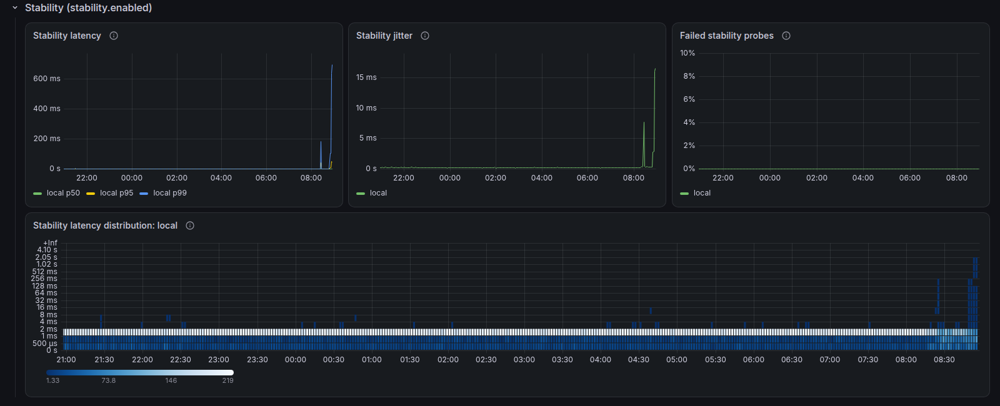

# User guide

This guide is the operations reference for librespeed-exporter. Installation is covered in the [README](../README.md) and design decisions in the [specification](spec.md).

## Flags

| Flag | Default | Description |
|---|---|---|
| `--config.file` | `librespeed-exporter.yml` | Configuration file. Can also come from the `LIBRESPEED_EXPORTER_CONFIG` environment variable |
| `--web.listen-address` | `:9469` | HTTP server address. Can be repeated to listen on several addresses |
| `--web.telemetry-path` | `/metrics` | Metrics path |
| `--web.config.file` | | TLS and basic auth file, in the [exporter-toolkit format](https://github.com/prometheus/exporter-toolkit/blob/master/docs/web-configuration.md) |
| `--log.level` | `info` | `debug`, `info`, `warn` or `error`. At `debug`, each test logs the librespeed-cli command line |
| `--log.format` | `logfmt` | `logfmt` or `json` |

## Configuration

The file is YAML. Only `servers` is required; [librespeed-exporter.example.yml](../librespeed-exporter.example.yml) lists every field with its default value. Unknown fields are rejected, so a typo does not go unnoticed.

### General

| Field | Default | Description |
|---|---|---|
| `interval` | `30m` | Time between the start of two cycles. Each cycle tests every server in sequence |
| `run_on_start` | `true` | Run a cycle at startup, without waiting for the first interval |
| `timeout` | `2m` | Maximum duration of one librespeed-cli run. When exceeded, the process gets `SIGTERM` and, 5s later, `SIGKILL` |
| `collect_client_info` | `false` | Expose `librespeed_client_info` with the public IP and ISP. When the server does not look up the ISP, the exporter gets the IP from the server's `ip_path` itself and leaves `isp` empty |
| `librespeed_cli.path` | empty | Path to librespeed-cli. Empty means looking it up in `PATH` |

Each scheduled cycle starts after a random delay of up to 10% of the interval, so several exporters started together do not test the same server at the same moment. The `run_on_start` cycle has no such delay. If a cycle is still running when the next one is due, the next one is skipped and a warning is logged.

### Test (`test`)

These fields become librespeed-cli flags and apply to every server.

| Field | Default | Flag | Description |
|---|---|---|---|
| `download` | `true` | `--no-download` when `false` | Measure download |
| `upload` | `true` | `--no-upload` when `false` | Measure upload |
| `duration` | `15s` | `--duration` | Duration of each phase, in whole seconds |
| `concurrent` | `3` | `--concurrent` | Parallel connections |
| `chunks` | `100` | `--chunks` | Size of each download request, in server chunks (1 MiB on the PHP backend) |
| `upload_size` | `1024KiB` | `--upload-size` | Size of each upload POST. Accepts `B`, `KiB`, `MiB` and `GiB`; must be a multiple of 1 KiB |
| `http_timeout` | `15s` | `--timeout` | Timeout of each HTTP request within the test |
| `ping_method` | `http` | `--no-icmp` when `http` | `http` or `icmp`. See [ICMP ping](#icmp-ping) |
| `ip_version` | `0` | `--ipv4` or `--ipv6` | `0` automatic, `4` or `6` |
| `source_address` | empty | `--source` | Source IP for the tests |
| `interface` | empty | `--interface` | Source interface for the tests. Cannot be combined with `source_address` |
| `no_preallocate` | `false` | `--no-pre-allocate` | Generate the upload payload on the fly. Uses less memory and more CPU |

### Stability (`stability`)

Continuous latency probing, the equivalent of the LibreSpeed web stability test. See [Stability probing](#stability-probing).

| Field | Default | Description |
|---|---|---|
| `enabled` | `false` | Probe every server continuously |
| `interval` | `1s` | Minimum time between two probes to the same server. At least `200ms` |
| `timeout` | `5s` | A probe that takes longer counts as failed |

### Servers (`servers`)

| Field | Default | Description |
|---|---|---|
| `name` | required | Unique name. Becomes the `server` label; the URL can change freely, but changing the name starts new series |
| `url` | required | Base URL of the LibreSpeed server, HTTP or HTTPS |
| `download_path` | `backend/garbage.php` | Download path, relative to `url` |
| `upload_path` | `backend/empty.php` | Upload path |
| `ping_path` | `backend/empty.php` | Ping path |
| `ip_path` | `backend/getIP.php` | IP and ISP lookup path |
| `insecure_skip_verify` | `false` | Accept an invalid or self-signed certificate (`--skip-cert-verify`) |
| `ca_file` | empty | PEM file with the server's CA (`--ca-cert`) |

The default paths are those of the LibreSpeed PHP backend, which is also what the official container image runs. Other backends may use different paths.

### Validation

The exporter does not start, and a reload is rejected, when:

- there are no servers, names are repeated or empty, or a URL is not HTTP or HTTPS;
- `interval` or `timeout` is not greater than zero;
- `duration` or `http_timeout` is not a whole number of seconds, of at least 1s;
- `ping_method` is neither `http` nor `icmp`, or `ip_version` is not 0, 4 or 6;
- `timeout` is less than 15s plus `duration` for each enabled phase (45s with the defaults);
- `concurrent` or `chunks` is less than 1, or `upload_size` is not a multiple of 1 KiB;
- `source_address` is not an IP, or is set together with `interface`;
- `stability.interval` is under 200ms, or `stability.timeout` is not greater than zero;
- `ca_file` does not exist.

Every problem is reported at once, with the path of the field, for example `servers[1].name: "lab" is already used by servers[0]`.

### Reload

`SIGHUP` or `POST /-/reload` rereads the file. If it is invalid, nothing changes: the error goes to the log, the `POST` returns 500 with the message, and `librespeed_config_last_reload_successful` stays at 0 until a reload succeeds. A test in progress finishes with the old configuration.

On reload, servers keep their history by `name`. Removed servers disappear from the metrics. If `librespeed_cli.path` changed, the new binary must answer `--version` before it is used.

## Endpoints

| Path | Description |
|---|---|
| `/` | Page linking the other endpoints |
| `/metrics` | Metrics |
| `/healthz` | Returns 200 while the process is up |
| `/-/reload` | `POST` reloads the configuration |

## Metrics

Speeds are in bytes per second and times in seconds. The `server` label is the `name` from the configuration.

### Result

| Metric | Type | Description |
|---|---|---|
| `librespeed_download_bytes_per_second` | gauge | Download speed of the last successful test |
| `librespeed_upload_bytes_per_second` | gauge | Upload speed of the last successful test |
| `librespeed_ping_seconds` | gauge | Mean latency of the last successful test |
| `librespeed_jitter_seconds` | gauge | Jitter of the last successful test |

These metrics appear after the first success and keep the last measured value when a test fails. A disabled phase produces no metric.

### State

| Metric | Type | Labels | Description |
|---|---|---|---|
| `librespeed_up` | gauge | `server` | 1 if the last test succeeded, 0 if it failed |
| `librespeed_last_test_timestamp_seconds` | gauge | `server` | When the last test finished, successful or not |
| `librespeed_last_success_timestamp_seconds` | gauge | `server` | When the last successful test finished |
| `librespeed_test_duration_seconds` | gauge | `server` | Duration of the last librespeed-cli run |
| `librespeed_tests_total` | counter | `server`, `result` | Tests run; `result` is `success` or `failure` |
| `librespeed_transferred_bytes_total` | counter | `server`, `direction` | Bytes of successful tests; `direction` is `download` or `upload` |
| `librespeed_test_running` | gauge | | 1 while librespeed-cli is running |
| `librespeed_config_last_reload_successful` | gauge | | 0 if the last reload failed |

### Stability

Only while `stability.enabled` is true.

| Metric | Type | Labels | Description |
|---|---|---|---|
| `librespeed_stability_latency_seconds` | histogram | `server` | Latency of successful probes |
| `librespeed_stability_jitter_seconds` | histogram | `server` | Latency difference between consecutive successful probes |
| `librespeed_stability_requests_total` | counter | `server`, `result` | Probes sent, by `success` or `failure` |

### Info

| Metric | Labels | Description |
|---|---|---|
| `librespeed_server_info` | `server`, `url` | Configured servers |
| `librespeed_client_info` | `server`, `ip`, `isp` | IP and ISP seen by the server. Only with `collect_client_info: true`. `isp` is empty when the server does not look it up; servers on the local network produce no series |
| `librespeed_cli_info` | `version` | librespeed-cli version |
| `librespeed_exporter_build_info` | `version`, `revision`, `goversion`, ... | Exporter version |

### Useful queries

```promql
# Download in Mbps
librespeed_download_bytes_per_second * 8 / 1e6

# Time since the last success
time() - librespeed_last_success_timestamp_seconds

# Data used by the tests over the last 24 hours
sum by (server) (increase(librespeed_transferred_bytes_total[1d]))

# Stability: 95th percentile latency over 5 minutes
histogram_quantile(0.95, sum by (server, le) (rate(librespeed_stability_latency_seconds_bucket[5m])))

# Stability: mean jitter over 5 minutes
sum by (server) (rate(librespeed_stability_jitter_seconds_sum[5m]))
  / sum by (server) (rate(librespeed_stability_jitter_seconds_count[5m]))

# Stability: share of failed probes over 5 minutes
sum by (server) (rate(librespeed_stability_requests_total{result="failure"}[5m]))
  / sum by (server) (rate(librespeed_stability_requests_total[5m]))
```

## Bandwidth use

A test transfers roughly `speed × duration` for each enabled phase. On a 500 Mbps link with `duration: 15s`:

- download: 500 Mbps × 15 s = 7,500 Mb ≈ 940 MB;
- upload: the same, on a symmetric link;
- with `interval: 30m`, 48 tests per day ≈ 90 GB per day, per server.

To reduce it, increase `interval`, reduce `duration` or disable one of the phases. librespeed-cli has no volume limit, so neither does the exporter.

## Stability probing

With `stability.enabled: true`, the exporter sends one small HTTP request to each server's `ping_path` every `stability.interval`, all the time, and records latency, jitter and failures. It is the same measurement as the stability test in the LibreSpeed web UI, run continuously so that short drops between speed tests show up in Prometheus.

- Latency is measured from the request being sent to the first response byte, over a kept-alive connection.
- A failure is a connection error, a non-200 response or a probe slower than `stability.timeout`. It is not packet loss.
- Probing pauses while a speed test runs, because the saturated link would show up as latency spikes.
- Probes use the server's `insecure_skip_verify` and `ca_file` and the test's `ip_version` and `source_address`. `test.interface` does not apply to them.
- Each probe is about 500 bytes of HTTP (measured against the official LibreSpeed image). With TCP/IP overhead, the default 1s interval adds up to roughly 2 GB per month per server. Ask before probing someone else's public server every second.

The example alert `LibrespeedStabilityFailures` fires when more than 5% of the probes fail for 10 minutes, and the example dashboard has a stability row with latency percentiles, jitter and failed requests.



## Kubernetes

Run a single replica with the `Recreate` deployment strategy. With `RollingUpdate`, the new pod starts testing while the old one is still running, so their tests can overlap and skew each other's results.

Every new pod gets new `pod` and `instance` labels, so each restart starts new series for the same `server`. Aggregate by `server` in queries that should show one line per server, as the example dashboard does:

```promql
max by (server) (librespeed_download_bytes_per_second)
```

With `run_on_start: true`, every pod start runs a test right away. A pod in a crash loop keeps testing, so keep an eye on `librespeed_transferred_bytes_total` on metered links.

## ICMP ping

With `ping_method: http` (the default), latency is measured with HTTP requests to the server. With `icmp`, librespeed-cli tries ICMP first and, if it cannot, silently falls back to HTTP. Since the two methods give different numbers, that switch can create steps in the graph that do not reflect the link.

On Linux, unprivileged ICMP requires the process group to be within `net.ipv4.ping_group_range`:

```sh
# container
docker run --sysctl net.ipv4.ping_group_range="0 2147483647" ...

# host (covers the dynamic user of the systemd unit)
sysctl -w net.ipv4.ping_group_range="0 2147483647"
```

## Troubleshooting

| Log message | Likely cause |
|---|---|
| `librespeed-cli returned no report; the server did not respond` | The server failed librespeed-cli's initial check: it is down, the URL is wrong or the paths do not match its backend |
| `librespeed-cli run timed out` | The test took longer than `timeout`. Increase `timeout` or reduce `duration` |
| `librespeed-cli reported a download speed of zero` | The download transferred nothing. Check `download_path` |
| `librespeed-cli is not usable` (at startup) | The binary was not found or did not answer `--version`. Check `librespeed_cli.path` |
| `Stability probe failing` / `Stability probe recovered` | Logged once when a server's probes start failing and once when they recover |
| `Stability probing disabled for server` | The server's `ca_file` could not be read or has no PEM certificate; that server is not probed |
| `Previous test cycle still running, skipping this one` | A cycle takes longer than `interval`. Increase `interval` or reduce the number of servers |

With `--log.level=debug`, each test logs its full command line, which can be run by hand to reproduce the problem. The server list goes on stdin; its JSON is described in the [specification](spec.md#one-run-per-server).
